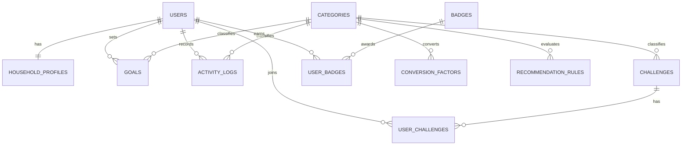

# SCSA Household Sustainability Database

This is a ready-to-use SQLite database package for the school MVP. It supports household accounts, profiles, goals, activity logging, challenges, badges, rule-based recommendations, conversion factors, and opt-in anonymous community reporting.

## Files

| File | Purpose |
|---|---|
| `schema.sql` | Creates all tables, constraints, indexes, and reporting views |
| `seed_and_demo.sql` | Inserts categories, rules, badges, challenges, and three demo households |
| `queries.sql` | Contains eight read-only website queries |
| `scsa_demo.db` | Pre-built SQLite database containing the schema and demo data |

## Quick start

Fastest option: open `scsa_demo.db` in any SQLite-compatible database viewer.

To build a clean database from the SQL files:

```bash
sqlite3 scsa.db < schema.sql
sqlite3 scsa.db < seed_and_demo.sql
sqlite3 scsa.db < queries.sql
```

The demo query examples use Alice's `user_id = 1`. Demo emails and password hashes are placeholders and are not production authentication credentials.

## ERD



## Primary-key and foreign-key summary

| Table | Primary key | Foreign keys | Important uniqueness |
|---|---|---|---|
| `users` | `user_id` | — | `email` |
| `household_profiles` | `profile_id` | `user_id → users.user_id` | `user_id` (one profile per user) |
| `categories` | `category_id` | — | `category_code`, `category_name` |
| `goals` | `goal_id` | `user_id → users.user_id`; `category_id → categories.category_id` | — |
| `activity_logs` | `log_id` | `user_id → users.user_id`; `category_id → categories.category_id` | — |
| `challenges` | `challenge_id` | `category_id → categories.category_id` | — |
| `user_challenges` | `user_challenge_id` | `user_id → users.user_id`; `challenge_id → challenges.challenge_id` | `(user_id, challenge_id)` |
| `badges` | `badge_id` | — | `badge_code`, `badge_name` |
| `user_badges` | `user_badge_id` | `user_id → users.user_id`; `badge_id → badges.badge_id` | `(user_id, badge_id)` |
| `conversion_factors` | `factor_id` | `category_id → categories.category_id` | `(category_id, effective_from)` |
| `recommendation_rules` | `rule_id` | `category_id → categories.category_id` | — |

## Data Dictionary

### `users`

Stores login-level account records. Passwords must be stored as secure hashes by the eventual backend.

| Field | Type | Required | Key/default | Meaning |
|---|---|---:|---|---|
| `user_id` | INTEGER | Yes | PK | User identifier |
| `email` | TEXT | Yes | UNIQUE | Login email, case-insensitive |
| `password_hash` | TEXT | Yes | — | Secure password hash; never store a plain password |
| `account_status` | TEXT | Yes | `active` | `active` or `disabled` |
| `created_at` | TEXT | Yes | current timestamp | Account creation time |
| `last_login_at` | TEXT | No | — | Most recent login time |

### `household_profiles`

Stores the household-facing profile separately from login information.

| Field | Type | Required | Key/default | Meaning |
|---|---|---:|---|---|
| `profile_id` | INTEGER | Yes | PK | Profile identifier |
| `user_id` | INTEGER | Yes | FK, UNIQUE | Owner; one profile per user |
| `display_name` | TEXT | Yes | — | Name shown in the website |
| `household_size` | INTEGER | Yes | `1` | Number of people in the household |
| `community_opt_in` | INTEGER | Yes | `0` | `1` permits anonymous aggregate reporting |
| `created_at` | TEXT | Yes | current timestamp | Creation time |
| `updated_at` | TEXT | Yes | current timestamp | Last update time, set by the application |

### `categories`

Defines the four tracking areas so the rest of the design does not repeat names and units.

| Field | Type | Required | Key/default | Meaning |
|---|---|---:|---|---|
| `category_id` | INTEGER | Yes | PK | Category identifier |
| `category_code` | TEXT | Yes | UNIQUE | Stable code such as `water` |
| `category_name` | TEXT | Yes | UNIQUE | Display name |
| `default_unit` | TEXT | Yes | — | `kWh`, `litres`, `kg`, or `count` |
| `progress_direction` | TEXT | Yes | — | Whether lower or higher values are desirable |
| `is_active` | INTEGER | Yes | `1` | Whether the category is available |

### `goals`

Stores a household's target for one category and date range.

| Field | Type | Required | Key/default | Meaning |
|---|---|---:|---|---|
| `goal_id` | INTEGER | Yes | PK | Goal identifier |
| `user_id` | INTEGER | Yes | FK | Goal owner |
| `category_id` | INTEGER | Yes | FK | Tracked category |
| `title` | TEXT | Yes | — | User-visible goal title |
| `target_value` | REAL | Yes | — | Desired maximum or minimum |
| `baseline_value` | REAL | No | — | Starting value for comparison |
| `period_type` | TEXT | Yes | — | `daily`, `weekly`, `monthly`, or `total` |
| `start_date` | TEXT | Yes | — | ISO date `YYYY-MM-DD` |
| `end_date` | TEXT | Yes | — | ISO date, not before the start |
| `status` | TEXT | Yes | `active` | Goal lifecycle state |
| `created_at` | TEXT | Yes | current timestamp | Creation time |

### `activity_logs`

This is the main fact table. Dashboard totals and trends should be calculated from these rows rather than saved separately.

| Field | Type | Required | Key/default | Meaning |
|---|---|---:|---|---|
| `log_id` | INTEGER | Yes | PK | Log identifier |
| `user_id` | INTEGER | Yes | FK | Household that recorded it |
| `category_id` | INTEGER | Yes | FK | Electricity, water, waste, or eco action |
| `amount` | REAL | Yes | non-negative | Measured amount in the category's default unit |
| `recorded_date` | TEXT | Yes | — | ISO activity date |
| `notes` | TEXT | No | — | Optional explanation |
| `created_at` | TEXT | Yes | current timestamp | Creation time |
| `updated_at` | TEXT | Yes | current timestamp | Last edit time, set by the application |

### `challenges`

Defines challenges available to households.

| Field | Type | Required | Key/default | Meaning |
|---|---|---:|---|---|
| `challenge_id` | INTEGER | Yes | PK | Challenge identifier |
| `category_id` | INTEGER | Yes | FK | Challenge category |
| `title` | TEXT | Yes | — | Display title |
| `description` | TEXT | Yes | — | Instructions |
| `target_value` | REAL | Yes | — | Completion target |
| `duration_days` | INTEGER | Yes | — | Intended length |
| `start_date` | TEXT | Yes | — | Availability start |
| `end_date` | TEXT | Yes | — | Availability end |
| `is_active` | INTEGER | Yes | `1` | Whether users can join |

### `user_challenges`

Bridge table for the many-to-many relationship between users and challenges.

| Field | Type | Required | Key/default | Meaning |
|---|---|---:|---|---|
| `user_challenge_id` | INTEGER | Yes | PK | Participation identifier |
| `user_id` | INTEGER | Yes | FK | Participant |
| `challenge_id` | INTEGER | Yes | FK | Joined challenge |
| `joined_at` | TEXT | Yes | current timestamp | Join time |
| `progress_value` | REAL | Yes | `0` | Current progress |
| `status` | TEXT | Yes | `joined` | `joined`, `completed`, or `abandoned` |
| `completed_at` | TEXT | No | — | Completion time |

### `badges`

Defines reusable badge rules and display information.

| Field | Type | Required | Key/default | Meaning |
|---|---|---:|---|---|
| `badge_id` | INTEGER | Yes | PK | Badge identifier |
| `badge_code` | TEXT | Yes | UNIQUE | Stable internal code |
| `badge_name` | TEXT | Yes | UNIQUE | Display name |
| `description` | TEXT | Yes | — | Earning condition in plain language |
| `condition_type` | TEXT | Yes | — | Type of metric to test |
| `threshold_value` | REAL | Yes | — | Required metric value |
| `icon_name` | TEXT | Yes | — | Front-end icon key |

### `user_badges`

Bridge table recording which users have earned which badges.

| Field | Type | Required | Key/default | Meaning |
|---|---|---:|---|---|
| `user_badge_id` | INTEGER | Yes | PK | Award identifier |
| `user_id` | INTEGER | Yes | FK | Recipient |
| `badge_id` | INTEGER | Yes | FK | Awarded badge |
| `awarded_at` | TEXT | Yes | current timestamp | Award time |

### `conversion_factors`

Stores versioned factors for optional estimated-impact calculations. The included values are illustrative only.

| Field | Type | Required | Key/default | Meaning |
|---|---|---:|---|---|
| `factor_id` | INTEGER | Yes | PK | Factor identifier |
| `category_id` | INTEGER | Yes | FK | Source category |
| `factor_value` | REAL | Yes | — | Output per one category unit |
| `output_unit` | TEXT | Yes | `kg CO2e` | Result unit |
| `source_name` | TEXT | Yes | — | Citation or demo warning |
| `source_url` | TEXT | No | — | Supporting source link |
| `effective_from` | TEXT | Yes | — | First valid date |
| `effective_to` | TEXT | No | — | Last valid date; blank means open-ended |
| `is_active` | INTEGER | Yes | `1` | Whether calculations may use it |

### `recommendation_rules`

Stores transparent threshold rules so recommendations do not require AI or machine learning.

| Field | Type | Required | Key/default | Meaning |
|---|---|---:|---|---|
| `rule_id` | INTEGER | Yes | PK | Rule identifier |
| `category_id` | INTEGER | Yes | FK | Metric to evaluate |
| `operator` | TEXT | Yes | — | Comparison such as `>` or `<` |
| `threshold_value` | REAL | Yes | — | Trigger threshold |
| `evaluation_days` | INTEGER | Yes | `30` | Intended look-back window |
| `message` | TEXT | Yes | — | Recommendation shown to the user |
| `priority` | INTEGER | Yes | `100` | Smaller values display first |
| `is_active` | INTEGER | Yes | `1` | Whether the rule is enabled |

## Design rules

- Enable `PRAGMA foreign_keys = ON` for every SQLite connection.
- Keep dates in ISO format (`YYYY-MM-DD`) and timestamps in UTC where possible.
- Never save dashboard totals, trends, percentages, or rankings as separate tables; derive them from `activity_logs`.
- Only aggregate community data from profiles with `community_opt_in = 1`.
- The included community queries suppress groups with fewer than three households.
- Hash passwords in the backend with a modern password hasher; do not use the demo values.
- Replace the illustrative conversion factors with cited project-approved values before presenting impact as factual.

## Website feature mapping

| Website feature | Tables/views used |
|---|---|
| Register and sign in | `users`, `household_profiles` |
| Set goals | `goals`, `categories`, `v_goal_progress` |
| Log energy/water/waste/actions | `activity_logs`, `categories` |
| Dashboard and charts | `activity_logs`, `v_goal_progress` |
| Join challenges | `challenges`, `user_challenges` |
| Earn badges | `badges`, `user_badges` |
| Get simple suggestions | `recommendation_rules`, `activity_logs` |
| Estimate impact | `conversion_factors`, `activity_logs` |
| Anonymous community report | `household_profiles`, `activity_logs`, `v_community_category_stats` |

